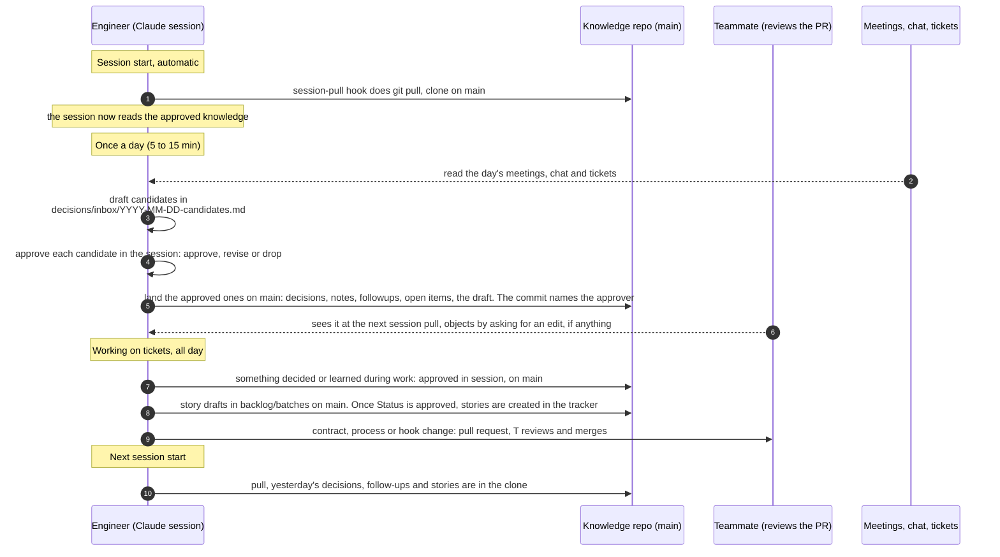

# Daily sync: how knowledge moves in a normal day

One engineer, one repo. Nothing here needs remembering except two habits: run
the sync once a day, and review the teammate's PR the same day when a contract
or a process changes.

What each person does by hand in a day: open Claude (the pull is automatic), run
the sync once if it is their turn, review and merge the other person's PR, and
save a decision or a fact in the repo when something is decided or learned
outside a meeting.
